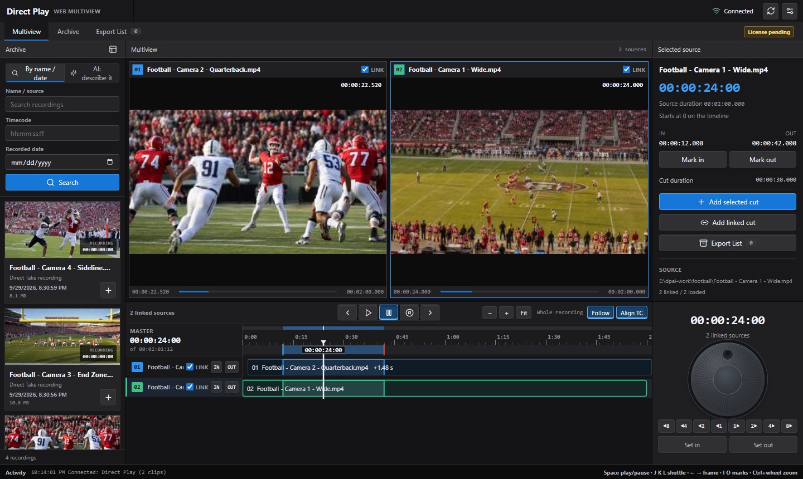
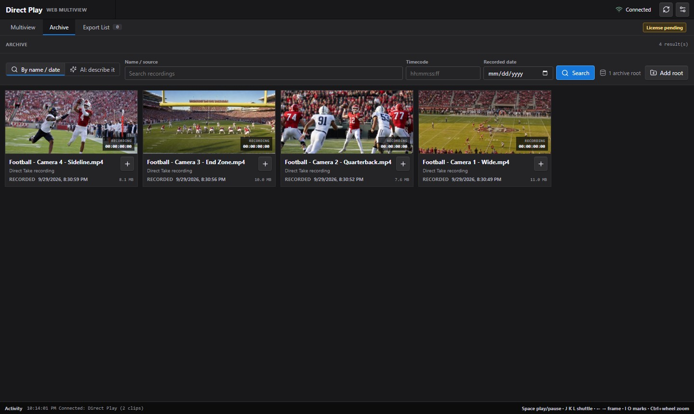

# Direct Play REST Dashboard

Browser dashboard for the Medialooks Direct Play REST API. It provides a focused workspace for synchronized playback, per-clip control, and archive search.





## Projects

- `directplay-js-client` - dependency-free ESM client for Direct Play REST.
- `directplay-web-dashboard` - Vite dashboard using the local client package.

## Run locally

```powershell
cd directplay-js-client
npm.cmd install
cd ..\directplay-web-dashboard
npm.cmd install
npm.cmd run dev
```

Open the Vite URL, normally `http://localhost:9002`.

The dashboard defaults to the local proxy at `/dp-api/`. To point the Vite proxy at another Direct Play host:

```powershell
$env:DIRECTPLAY_REST_TARGET = "http://127.0.0.1:9532"
npm.cmd run dev
```

Direct Play requires the REST token from **Preferences > REST API**. The dashboard keeps the API URL and token in browser local storage.

## What it does

- **Multiview**: live previews of every loaded source, per-source transport, audio preview and IN/OUT.
- **Timeline** (same model as the desktop player): one time scale for the ruler and every source; sources recorded
  with time-of-day timecode are drawn where they start (**Align TC**, `playback/alignment/{timecode|off}`).
  Click or drag to move the playhead (a drag seeks continuously, one request in flight); as on the desktop, the wheel
  scrolls, Ctrl+wheel zooms and Alt+wheel steps frames; double-click the ruler for the whole recording. **Follow** turns the
  page while playing. The playhead is extrapolated from Direct Play's master clock between polls, so it moves smoothly.
- **Transport**: play/pause/stop/frame step for linked sources, a jog wheel (drag round or turn the wheel: one frame per
  15 degrees) and shuttle speeds from 8x reverse to 8x forward (`playback/sync-shuttle/{rate}`).
- **Keyboard** (Multiview tab): Space play/pause, J/K/L shuttle (repeat J or L to go faster), Left/Right one frame
  (hold to accelerate), Shift+Left/Right one second, I/O marks, Home/End, +/- zoom, \ whole recording, Esc back.
- **Archive**: search by name, timecode and date, or describe people, objects or events for the AI search
  (`api/ai/search`); a click on a found moment opens the recording at that point.
- **Export List**: queued cuts, re-encode options, running exports.
- **Settings**: preview rate and AI search settings with a description of every choice (`api/ai/settings`).

Shuttle and alignment need Direct Play with the `sync-shuttle` and `alignment` playback commands; older versions keep
working and report that the command is not supported.

## Code layout (`directplay-web-dashboard/src`)

| File | Role |
|---|---|
| `main.js` | Start-up: registers the views and starts polling |
| `store.js` | State, the REST client, master timeline values (with clock extrapolation) |
| `data.js` | Polling, actions, archive and AI search, thumbnails, live previews |
| `dom.js` | HTML rendering with in-place updates of live values |
| `timeline.js` | Canvas timeline: drawing, zoom/follow, scrubbing |
| `actions.js` | Buttons, inputs, jog wheel and keyboard |
| `views/*.js` | HTML of the page frame, multiview, archive and export list |
| `timeline.css` | Timeline dock and transport panel (on top of `styles.css` and `workbench.css`) |

## How the dashboard stays light

- The page is rebuilt only when its structure changes. Values that move during playback (times, progress, meters,
  play state) are marked `data-live` and patched in place, so previews do not flicker and typing is never interrupted.
- Each poll (every 1.5 s) reads application state and clips only. Archive roots are re-read every 15 s and the export
  list every 10 s, or on every poll while the Export List is open or an export runs. Polling pauses while the browser
  tab is hidden.
- Transport, jog, seek and mark actions refresh only the clips and the master clock.
- The timeline canvas animates only while the master clock runs or the playhead is dragged.
- Live previews: one picture per tick, round robin over sources that changed (default 3 per second).
- Archive thumbnails are requested once per file (up to 24 per result list).

## Build

```powershell
cd directplay-web-dashboard
npm.cmd run build
```
